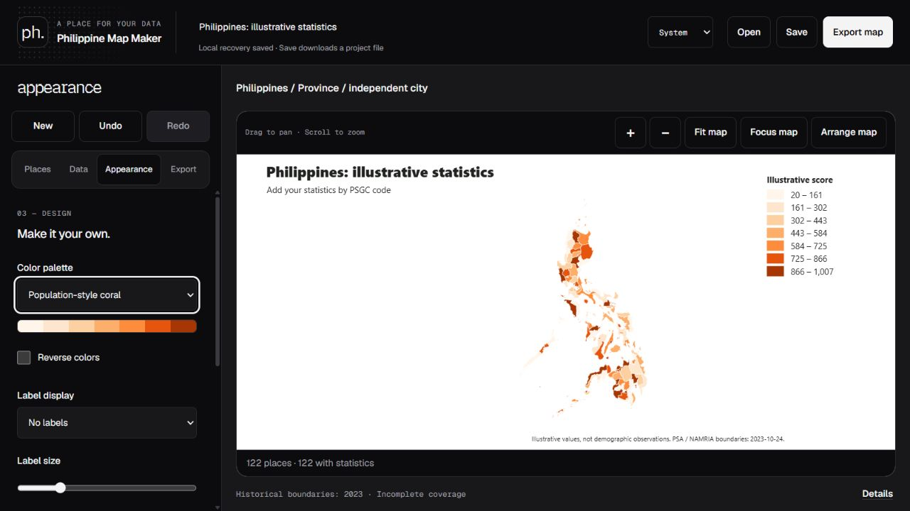
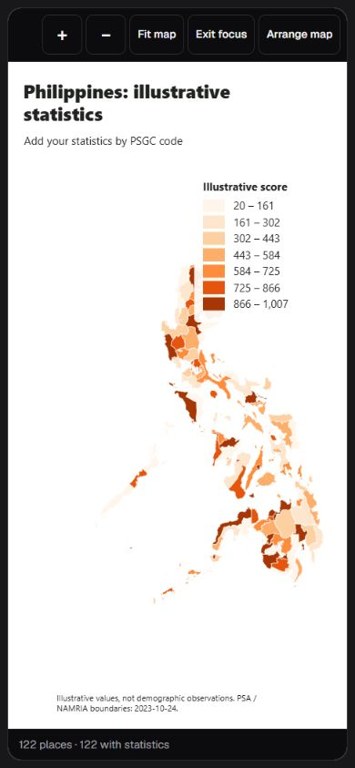

# Philippine Demographic Mapper

Create Philippine choropleth maps from PSGC-coded CSV data, edit individual places, and export a map with your own colors, labels and legend. Runs in your browser without an account or an application upload service.

[Open the live editor](https://geoceff.github.io/philippine-demographic-mapper/) · [Data tools](tools/README.md) · [Contributing](CONTRIBUTING.md) · [Changelog](CHANGELOG.md)



*The screenshot uses made-up example scores. Boundaries are a historical, incomplete 2023 snapshot; the app does not supply current population observations or certify legal boundaries.*

## What you can do

| Task | Tools |
|---|---|
| Explore places | Region, province/independent city, city/municipality and barangay layers; national or focused scopes; place/code search and child-map navigation |
| Add statistics | PSGC CSV templates, column selection, import diagnostics, manual values and annotations; zero and missing values remain distinct |
| Design the map | Sequential palettes, classification/custom breaks, border presets, labels, missing-data styles and editable legend colors/text |
| Arrange the output | Drag title, subtitle, source and legend; use keyboard nudges, numeric positions or presets |
| Keep working | JSON project files with camera/metric settings, local recovery, unfinished drafts, New and bounded Undo/Redo |
| Export | PNG/SVG, transparent or solid backgrounds, size presets, custom dimensions and page preview |
| Use less screen space | Focus map, one mobile tools sheet, mouse/wheel or touch/pinch navigation, light/dark/system themes |

The interface follows a restrained monochrome direction inspired by [Bryl Lim](https://bryllim.com/), using self-hosted Geist fonts. Map colors remain independent of the interface theme. Keyboard controls, visible focus and reduced-motion support are included; full assistive-technology and cross-browser verification remains ongoing.

<details>
<summary>Mobile Focus map example</summary>



The same made-up example scores, with secondary chrome hidden for a larger map.

</details>

## Run locally

Use **Node.js 24**, the runtime tested in CI. There are no npm dependencies to install.

```powershell
git clone https://github.com/GeoCeff/philippine-demographic-mapper.git
cd philippine-demographic-mapper
npm run boundaries:full
npm run serve
```

Open [http://127.0.0.1:4173/](http://127.0.0.1:4173/). Use the server rather than opening `index.html` through `file://` so the browser can fetch the map files.

The first full build downloads approximately 400 MB of pinned sources and produces approximately 370 MB of generated overview/detail data. Allow disk space for source files, outputs and staging. Matching cached inputs are reused. Raw GIS files and generated map packages are ignored by Git; GitHub Pages builds its own package.

For a smaller overview-only setup, run `npm run boundaries:barangays` instead of `boundaries:full`. Original detailed borders require the additional detail stage. Running a base build replaces its index, so follow it with `npm run boundaries:detail` to restore detail descriptors.

## Make a map

1. **Places:** choose an Area and Map level. Search by name or PSGC code; ambiguous names need a specific code. The province layer includes independent cities so their areas are represented.
2. **Data:** download a template or import a CSV. Confirm the identifier and statistic columns. Review unmatched, wrong-level, outside-scope, duplicate and invalid-value rows before publishing. **Try sample data** creates illustrative numbers only.
3. **Edit:** click a place, or focus a boundary and press Enter. Apply a value/custom label; a blank value explicitly clears the statistic, and zero remains valid. Applied manual edits take precedence over the CSV.
4. **Appearance:** choose colors, classification, labels and border styles. Customize the legend, then use **Map text and layout** for the title, subtitle and source. **Arrange map** moves layout elements; arrow keys nudge, Shift moves farther and Escape finishes.
5. **Export:** frame the map using pan/zoom, optionally enable page preview, choose PNG/SVG and dimensions, then download. Changing aspect ratio may add margins to retain the view. Editor handles are removed from output.
6. **Save:** download an editable JSON project. Open restores its data, appearance and camera. Apply unfinished fields before saving a file; local recovery separately retains drafts.

Example CSV — these numbers are illustrative:

```csv
psgc_code,name,value,label
0702200000,Cebu,1250,Study area
1381300000,Quezon City,3200,Priority area
```

PSGC means **Philippine Standard Geographic Code**: it identifies a place, not its population. Keep codes as text to preserve leading zeros. Imports reject duplicate headers, inconsistent row widths and unfinished quotes; files above 25 MB are rejected. Generated issue metadata cannot be replaced by identically named input columns.

**Data → Metric details and local recovery** stores a unit, reference period, source and automatic/explicit decimal preference. These labels do not convert the underlying numbers. Automatic formatting preserves small nonzero rates. Equal ranges, quantiles, continuous color, highlight and custom breaks are supported; custom display labels do not change their thresholds. Individual class styling supports up to 32 groups, and visible place labels are capped at 200 with overlap avoidance.

## Projects, recovery and privacy

Applied work and drafts can be recovered from one IndexedDB copy in this browser origin. On reload, choose Restore map or Discard recovery. Recovery is separate from a project-file download; storage failures are shown. Clear the copy under Metric details and local recovery. New edits create a new copy. Undo/Redo history is bounded to 30 steps/16 MB, retaining one larger current state when necessary.

CSV statistics and project data are processed in the browser; the editor does not upload them to an application service. A hosted visit still requests static app/boundary assets, and first use is not an offline installation. Saving JSON or exporting an image writes a download to your device. Avoid sharing files or screenshots containing private data in public issues.

## Boundary source and coverage

| Property | Current package |
|---|---|
| Curated release | [`v2026.4.13.0`](https://github.com/bendlikeabamboo/barangay-boundaries-repository/releases/tag/v2026.4.13.0) |
| Administrative snapshot | PSGC 2023-10-24; NAMRIA 2023-11-06 |
| Admin geometry | 17 regions, 82 provinces and 1,635 city/municipal records |
| Barangay geometry | 42,026 records representing 41,803 distinct PSGC codes |
| Original detail | 1,633 gzip city chunks; province descriptors reuse city chunks |
| Original source | [Pinned community mirror of the 2023 NAMRIA/OCHA shapefile](https://github.com/altcoder/philippines-psgc-shapefiles/tree/a44a73091f19e4950dbdc0d7cb77a5e17b101a0a/data/2023/BgySubMuns) |

Overview geometry retains the upstream 0.005° simplification. The native ADM4 reader preserves original vertices, islands and holes for detailed views; it does not buffer gaps or invent missing polygons. Large maps batch same-color geometry, cull outside a buffered view and use indexed hit testing. Focused province/city maps use original detail; close national/regional views request it within bounded budgets. The footer distinguishes overview, loading, detailed, partial and fallback states.

The source reports missing polygons, repeated PSGC assignments and approximate matches. Polygon count is not a count of unique current administrative units. Independent-city geographic province nesting does not imply administrative subordination. A saved-source mismatch is disclosed when opening a project. Review the generated `data/generated/boundary_coverage_report.json` and source metadata before making accuracy claims.

## Development and verification

```powershell
npm test
npm run boundaries:check
```

`npm test` runs local fixtures and regressions for imports/projects, classification, UI state, recovery, navigation, geometry, loading races, binary readers, staged publication and server requests. It does not certify real-device accessibility, every browser, long-session memory behavior or current legal geography.

`boundaries:check` is **read-only** and requires the complete built package. It verifies indexed coarse/detail files, hashes, membership, provenance and original detailed geometry. `boundaries:full` builds the pinned complete package and then checks it. `npm run check` is the shorter syntax/import/fixture pass.

For custom PSGC/GeoJSON reconciliation, keep outputs separate from the app's pinned package:

```powershell
node tools/data-pipeline.mjs --psgc data/raw/custom_psgc.csv --boundaries data/raw/custom_boundaries.geojson --out exports/custom/generated --report exports/custom/reconciliation.md --metadata exports/custom/source_metadata.json
```

This general importer produces reconciliation outputs; it does not rebuild the pinned barangay index/detail package. See [tools/README.md](tools/README.md) for commands, schemas, budgets and source caveats.

## Repository layout

- `index.html`, `styles.css`, `src/`: static editor, map/data logic, exports and project recovery.
- `tools/`: pinned boundary builders, native SHP/DBF reader, validators, fault tests and local checks.
- `data/raw/`, `data/generated/`: ignored local source/build files; their READMEs describe the package.
- `sample-data/`: illustrative CSVs and deliberate matching-error examples.
- `assets/fonts/`: self-hosted fonts and their license notices.
- `docs/images/`: public-safe showcase screenshots using illustrative statistics.
- `.github/workflows/pages.yml`: tests, complete pinned build and GitHub Pages deployment on `master`.

## Next work

- A verified newer official hierarchy, explicit crosswalks and better scope-level coverage reporting.
- Broader keyboard/screen-reader, real-touch, Firefox/Safari and export-image verification.
- Measured vertex/memory budgets and worker/tile rendering only where profiling justifies them.
- Publication tools such as insets, callouts and richer layout templates.

[MAP_MAKER_PLAN.md](MAP_MAKER_PLAN.md) separates implemented behavior from longer-term proposals. Contributions should preserve source records, local-first handling and explicit coverage limitations. Read [CONTRIBUTING.md](CONTRIBUTING.md) and [SECURITY.md](SECURITY.md).

## License and attribution

App code: **MIT**, see [LICENSE](LICENSE). Boundary data retains PSA/NAMRIA attribution and source terms; an upstream repository's MIT code license is not a blanket license for its data. Font notices are in [assets/fonts/README.md](assets/fonts/README.md). Check source terms and reconciliation evidence before redistributing a derived dataset.
